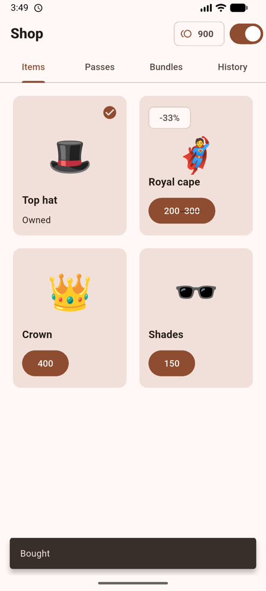
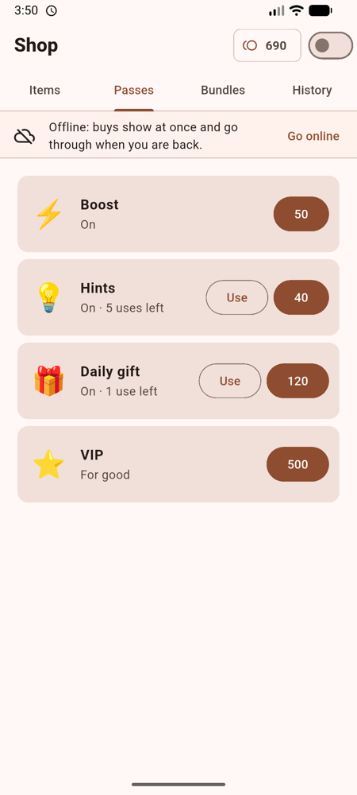
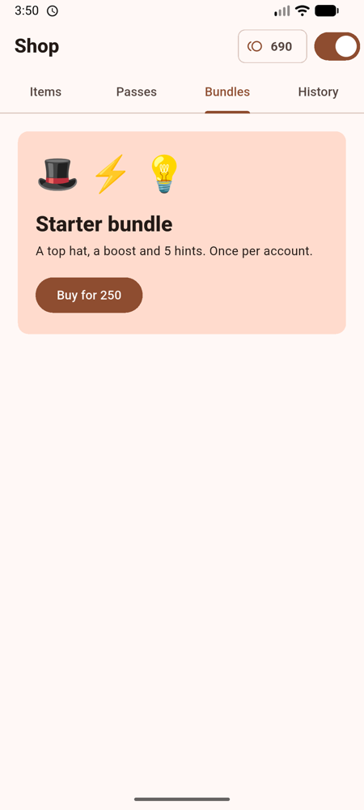
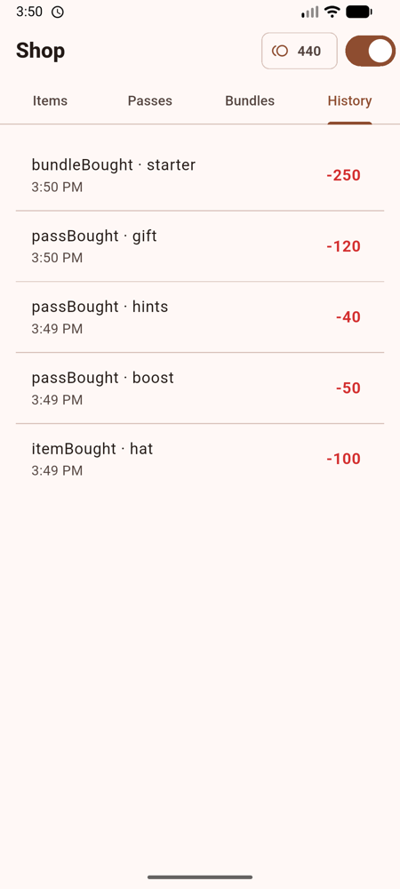
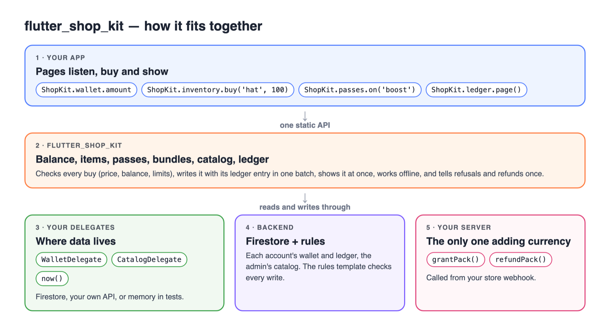
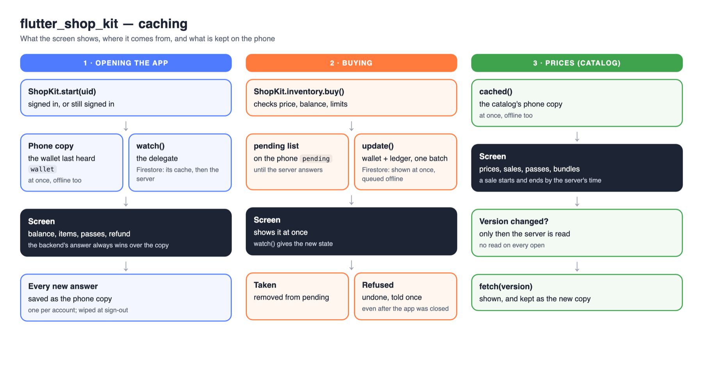

# flutter_shop_kit

An in-app shop for a virtual currency (coins, gems, points…): the account's **balance**, the **items** it owns, **passes**
of six kinds, and **bundles**, all bought **offline too**, priced from a remote **catalog** with sales and buying limits.
It holds no backend of its own: your app gives it one through a small delegate, and a Firestore security rules template
keeps every buy honest on the server.

<p>
  
  
  
  
</p>

<sub>The <code>example/</code> app: items with a sale, passes bought offline, a bundle, and the history.</sub>

```dart
ShopKit.wallet.amount                     // 1350
ShopKit.inventory.owns('hat')             // true
ShopKit.passes.on('boost')                // true while it runs
await ShopKit.passes.buy('boost', ShopKit.catalog.pass('boost')!);
await ShopKit.bundles.buy('starter', ShopKit.catalog.bundle('starter')!);
```

## Features

- **One entry point**: `ShopKit.setup`, `ShopKit.start`, `ShopKit.clear`, and its parts `wallet`, `inventory`, `passes`,
  `bundles`, `catalog`. Each part is a `Listenable` that tells only when its own part changes.
- **Offline buying**: a buy shows at once, waits in the backend's queue while offline, goes through once back online,
  and is undone by itself if the server refuses it (kept in `ShopKit.wallet.refusals` for the screen to say so, each once: `seen`),
  even when the app was closed in between: the next start checks the spends it left on their way.
- **Six pass types**: duration (can stack), counter (with a most-held `max`), lifetime, daily, limited, until a date.
- **Bundles**: items and up to 3 passes in one spend.
- **Catalog from the server**: prices, timed sales, buying limits (`count` in each `minutes`, or for good), new items
  and passes without an app release.
- **Ledger**: every spend recorded as a debit in the same batch (offline too); credits and refunds written by your
  server; read a page at a time for a history screen or support.
- **Refunds told once**: a refund your server takes back writes `lastRefund` on the wallet; `ShopKit.wallet.refund`
  gives it until `seenRefund()`, so the app says it once, on any phone.
- **Refund debt**: a refund your server takes back in full can leave the balance below zero; `ShopKit.wallet.debt`
  says how much is owed, and nothing can be spent (`SpendResult.inDebt`) until bought currency pays it back.
- **Server-checked**: a Firestore rules template checks every price, balance, pass, limit and ledger entry.
- **Currency-neutral and backend-agnostic**: Firestore, your own API, or memory in tests.

## How a buy flows

```
 User taps "Buy"
       │
       ▼
 ShopKit.passes.buy(id, terms)          terms = ShopKit.catalog.pass(id): the price shown is the price charged
       │
       ├─ until-pass past its date ─────────────► SpendResult.failed
       ├─ counter past its max ─────────────────► SpendResult.overLimit
       ├─ already held (and doesn't stack) ─────► SpendResult.done      (nothing taken)
       ├─ buying limit reached ─────────────────► SpendResult.overLimit
       ├─ balance below zero (a refund's debt) ─► SpendResult.inDebt
       ├─ balance too low ──────────────────────► SpendResult.notEnough
       │
       ▼
 ONE batch: wallet (price off, pass on, buy counted, lastWrite) + its ledger debit
       │
       ├─ shows on the phone at once (ShopKit.wallet / .passes tell their listeners)
       │
       ├─ online, server says yes ──────────────► SpendResult.done
       ├─ offline, or server slow (10 s) ───────► SpendResult.pending   (goes through when back)
       │        └─ server refuses later ────────► undone by itself, kept in wallet.refusals
       └─ online, server refuses ───────────────► SpendResult.failed    (undone)
```

Items (`inventory.buy`) and bundles (`bundles.buy`) flow the same way; a pass's use (`passes.use`) takes no currency.

## Architecture




| What the app gives | What it does | Firestore example |
|---|---|---|
| `WalletDelegate` | Hears and writes the account's wallet; the server's increment, list union and time | the wallet document |
| `CatalogDelegate` | The admin's catalog: the phone's copy, the server's at a version | `config/shop`, cached |
| `now` (a function, optional) | The server's time, so passes, sales and limits match the rules | a server-time offset |
| `ErrorReporter` | Records unexpected errors (optional) | Crashlytics |

`WalletDelegate` must show a write in `watch` at once and keep it in a queue while offline. Firestore does both by itself;
with another backend, your delegate does.

## Data

The wallet document (one per account):

```json
{
  "points": { "amount": 1350, "last_purchase_at": "…", "last_purchase_amount": 1200 },
  "items": ["hat", "cape"],
  "passes": {
    "boost": { "from": "…", "minutes": 30 },
    "hints": { "left": 12 },
    "vip":   { "owned": true },
    "gift":  { "from": "…", "days": 7, "count": 1, "window": 2, "used": 0 },
    "supers":{ "from": "…", "minutes": 1440, "left": 3 },
    "eid":   { "until": "…" }
  },
  "passBuys":   { "deal":    { "count": 1, "from": "…" } },
  "bundleBuys": { "starter": { "count": 1, "from": "…" } },
  "lastWrite":  { "kind": "bundleBought", "id": "starter" }
}
```

`points` is the balance whatever your currency is called; only your server adds to it. `lastWrite` is for the security
rules alone (they can't find which pass changed, or which ledger entry goes with a spend).

The ledger, under the wallet (`ledger/{id}`), one entry per balance movement, never changed:

```json
{ "kind": "debit", "reason": "itemBought", "ref": "hat", "amount": -100, "at": "…", "source": "app" }
{ "kind": "credit", "reason": "packBought", "ref": "GPA.1234", "amount": 500, "at": "…", "source": "server" }
```

The catalog (times as milliseconds since the epoch, UTC, in what `CatalogDelegate` gives):

```json
{
  "items":   { "hat": { "price": 100 }, "cape": { "price": 300, "sale": { "price": 200, "from": 0, "until": 0 } } },
  "passes":  {
    "boost":  { "type": "duration", "minutes": 30, "stack": true, "price": 50 },
    "hints":  { "type": "counter", "count": 5, "max": 20, "price": 40 },
    "vip":    { "type": "lifetime", "price": 500 },
    "gift":   { "type": "daily", "days": 7, "count": 1, "price": 120 },
    "supers": { "type": "limited", "minutes": 1440, "count": 3, "price": 80 },
    "eid":    { "type": "until", "until": 0, "price": 90 },
    "deal":   { "type": "counter", "count": 5, "price": 40, "limit": { "count": 1, "minutes": 1440 } }
  },
  "bundles": { "starter": { "price": 250, "items": ["hat"], "passes": ["boost", "hints"], "limit": { "count": 1 } } }
}
```

| Pass type | Gives | Bought again |
|---|---|---|
| `duration` | on for `minutes` | once over; with `stack`, adds its minutes while running |
| `counter` | `count` uses | any time, up to `max` held |
| `lifetime` | on for good | never |
| `daily` | `count` uses in each 24 hours, for `days` | once its days are over |
| `limited` | `count` uses within `minutes` | once its uses or minutes are over |
| `until` | on until the catalog's date | not after the date |

## Getting started

### 1. Add it

```yaml
dependencies:
  flutter_shop_kit: ^0.1.0
```

### 2. Write the delegates (Firestore)

```dart
class FirestoreWalletDelegate implements WalletDelegate {
  final _db = FirebaseFirestore.instance;
  DocumentReference<Map<String, dynamic>> _doc(String uid) => _db.doc('accounts/$uid/wallet/main');

  @override
  Stream<Map<String, dynamic>?> watch(String uid) => _doc(uid).snapshots().map((s) => s.data());
  @override
  Future<void> update(String uid, Map<String, Object?> change, {LedgerWrite? entry}) {
    final batch = _db.batch()..update(_doc(uid), change);
    if (entry != null) batch.set(_doc(uid).collection('ledger').doc(entry.id), entry.data);
    return batch.commit();
  }
  @override
  String newEntryId(String uid) => _doc(uid).collection('ledger').doc().id;
  @override
  Future<String?> loadLocal(String uid, String name) async => prefs.getString('shop_kit_${name}_$uid');
  @override
  Future<void> saveLocal(String uid, String name, String? text) =>
      text == null ? prefs.remove('shop_kit_${name}_$uid') : prefs.setString('shop_kit_${name}_$uid', text);
  @override
  Future<void> settled() => _db.waitForPendingWrites();
  @override
  Future<bool?> entryOnServer(String uid, String id) async {
    try {
      return (await _doc(uid).collection('ledger').doc(id).get(const GetOptions(source: Source.server))).exists;
    } catch (_) {
      return null;
    }
  }
  @override
  Future<List<({String id, Map<String, dynamic> data})>> ledger(String uid, {String? afterId, required int limit}) async {
    var query = _doc(uid).collection('ledger').orderBy('at', descending: true).limit(limit);
    if (afterId != null) query = query.startAfterDocument(await _doc(uid).collection('ledger').doc(afterId).get());
    final page = await query.get();
    return [for (final d in page.docs) (id: d.id, data: d.data())];
  }
  @override
  Object increment(int by) => FieldValue.increment(by);
  @override
  Object arrayUnion(List<Object?> values) => FieldValue.arrayUnion(values);
  @override
  Object get serverTime => FieldValue.serverTimestamp();
  @override
  Object storedTime(DateTime time) => Timestamp.fromDate(time);
  @override
  DateTime? timeOf(Object? value) => value is Timestamp ? value.toDate() : null;
  @override
  bool get online => true; // or your connectivity check
  @override
  bool unreachable(Object error) => error is TimeoutException || (error is FirebaseException && error.code == 'unavailable');
}
```

`CatalogDelegate` reads `config/shop` (converting `Timestamp`s to milliseconds) and keeps a copy on the phone; `now` gives
the server's time (for example `DateTime.now()` plus an offset from your server). Without `now`, the phone's clock is
used, which its owner can move, so a real shop gives the server's: the rules go by it.

### 3. Set it up once, start and clear with the account

```dart
void main() async {
  WidgetsFlutterBinding.ensureInitialized();
  await Firebase.initializeApp();
  ShopKit.setup(
    walletDelegate: FirestoreWalletDelegate(),
    now: () => myServerClock.now,
    catalogDelegate: MyCatalogDelegate(),
    onError: (e, s, where) => FirebaseCrashlytics.instance.recordError(e, s, reason: where),
  );
  runApp(const MyApp());
}

// at sign-in / sign-out
ShopKit.start(user.uid);
await ShopKit.clear();
```

### 4. Copy the security rules

Copy `rules/firestore.rules` into your rules and change the paths marked `CHANGE`.

### 5. Give currency from your server

Call `grantPack` and `refundPack` from your store webhook: see [Server side](#server-side-packs-and-refunds).

## Offline, and after the app was closed



The screen always reads the kit (`ShopKit.wallet`, `.inventory`, `.passes`…). What it shows when the app opens offline:

| What | Where it comes from | With Firestore | With your own backend |
|---|---|---|---|
| Balance, items, passes, a refund | The wallet last heard, kept on the phone by the kit (`loadLocal`/`saveLocal`, `wallet`) until the backend answers | ✅ | ✅ |
| Prices, sales, passes, bundles | `CatalogDelegate.cached()` | ✅ (your copy) | ✅ when you keep a copy |
| A buy made offline, shown at once | Your `WalletDelegate`: `watch` shows it, `update` queues it | ✅ Firestore does it | Your delegate keeps a queue |
| A buy refused after the app was closed | The kit's list of spends on their way (`pending`), checked at the next start | ✅ | ✅ |
| The history | `WalletDelegate.ledger()` | ✅ pages seen before | As your delegate keeps them |
| The time | `now()` | The server's offset you give | The server's offset you give |

So with any backend the screen shows the last known balance and what is owned at once, offline too; buying offline
also needs the delegate to show and queue its writes, as Firestore does.

## Server side: packs and refunds

Only your server adds currency or takes it back; the app can't (the rules refuse it). Call these from your store's
webhook (RevenueCat, App Store Server Notifications or Google Play's real-time notifications). A ready example for
Cloud Functions with the Admin SDK is in [`server/firebase_functions.ts`](server/firebase_functions.ts).

**A pack bought** (`grantPack(uid, transaction, points, product)`), in one transaction:

1. Stop if `accounts/{uid}/purchases/points_{transaction}` exists (a webhook is retried; a pack counts once), else create it.
2. On the wallet: `points.amount` up by the pack (`increment`), `points.last_purchase_at` (server time) and
   `points.last_purchase_amount`, so the app can say "you've got N" (`ShopKit.wallet.purchaseAfter`).
3. In the ledger: `ledger/points_{transaction}`, a `credit` of `packBought` for the transaction, `source: server`.

**A pack refunded** (`refundPack(uid, transaction)`), in one transaction:

1. Stop if the purchase is unknown or already has `refundedAt`; else mark it.
2. On the wallet: `points.amount` down by **all** the pack gave, even below zero: what was spent becomes a debt
   (`ShopKit.wallet.debt`), and nothing can be bought (`SpendResult.inDebt`) until a pack pays it back.
3. `lastRefund: {ref, amount, at}` on the wallet, so the app can tell it once (`ShopKit.wallet.refund`, then
   `seenRefund()`, which the rules let the app write).
4. In the ledger: `ledger/refund_{transaction}`, a `debit` of `refund`, `source: server`.

## Example shop UIs

A balance chip that rebuilds only when the balance changes:

```dart
ListenableBuilder(
  listenable: ShopKit.wallet,
  builder: (context, _) => Chip(label: Text('${ShopKit.wallet.amount} coins')),
);
```

An item with its sale:

```dart
ListenableBuilder(
  listenable: Listenable.merge([ShopKit.inventory, ShopKit.catalog]),
  builder: (context, _) {
    final offer = ShopKit.catalog.offer('cape')!, now = myServerClock.now; // the time given to ShopKit.setup
    return ListTile(
      title: const Text('Cape'),
      subtitle: Text(offer.onSale(now) ? '${offer.priceAt(now)} (was ${offer.price})' : '${offer.price}'),
      trailing: ShopKit.inventory.owns('cape')
          ? const Icon(Icons.check)
          : FilledButton(onPressed: () => ShopKit.inventory.buy('cape', offer.priceAt(now)), child: const Text('Buy')),
    );
  },
);
```

A pass with its uses:

```dart
ListenableBuilder(
  listenable: ShopKit.passes,
  builder: (context, _) => ListTile(
    title: const Text('Hints'),
    subtitle: Text(ShopKit.passes.on('hints') ? '${ShopKit.passes.left('hints')} left' : 'Not bought'),
    trailing: FilledButton(onPressed: () => ShopKit.passes.buy('hints', ShopKit.catalog.pass('hints')!), child: const Text('Buy')),
  ),
);
```

Saying how a buy went:

```dart
final result = await ShopKit.bundles.buy('starter', ShopKit.catalog.bundle('starter')!);
final text = switch (result) {
  SpendResult.done => 'Bought',
  SpendResult.pending => 'Bought: it goes through once you are back online',
  SpendResult.notEnough => 'Not enough coins',
  SpendResult.inDebt => 'Buy coins to pay back what you owe first',
  SpendResult.overLimit => 'You have it already, or its limit is reached',
  SpendResult.offline || SpendResult.failed => "Couldn't buy it",
};
```

A history list, a page at a time:

```dart
final entries = await ShopKit.ledger.page();               // newest 20
final more = await ShopKit.ledger.page(after: entries.last); // the next 20
for (final e in entries) print('${e.reason} ${e.ref}: ${e.amount}');
```

The `example/` app is a whole shop on a wallet kept in memory, with a switch to go offline and watch buys wait.

## Testing

Give `ShopKit.setup` a fake `WalletDelegate` (see `test/fakes/fake_wallet_delegate.dart`), and call `ShopKit.reset()` between
tests.

## Notes

- The ledger and the history can be turned off by the app: `ShopKit.setup(ledger: …, history: …)`. Ledger off: one
  write less per spend, and a spend refused after the app was closed isn't told (it is found by its ledger entry).
- A bundle holds up to 3 passes: the rules check each by itself, as rules can't loop.
- A daily pass counts 24-hour windows from when it was bought (rules can't know a phone's time zone).
- The wallet's field names (`points`, `items`, `passes`…) are fixed: the rules template uses them too.
